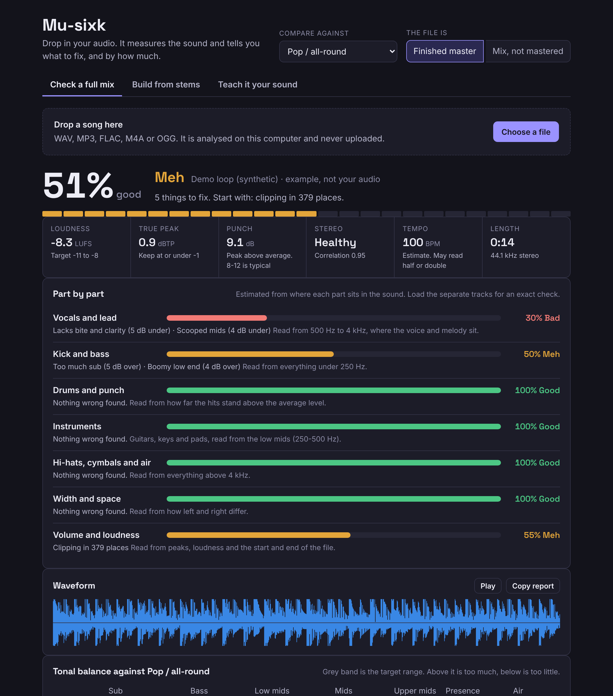

# Mu-sixk

Free mix feedback for your PC. Drop in audio, and it measures the sound and tells you what to fix and by how much.

Nothing is uploaded. All analysis runs on your computer, in the browser.



## Use it

Download `index.html` and double-click it. It opens in Chrome, Edge or Firefox. There is nothing to install.

| Tab | What you give it | What you get |
|---|---|---|
| **Check a full mix** | One song (WAV, MP3, FLAC, M4A, OGG) | An overall percentage (Good / Decent / Meh / Rough), a grade for each part (vocals, kick and bass, drums, instruments, top end, width, volume), loudness, true peak, punch, stereo and tempo readings, a tonal-balance chart against the style you pick, and a ranked list of fixes with amounts. For a finished master: what each streaming service will do to its volume, plus checks for over-limiting, MP3-sourced audio, rumble, silence and abrupt endings. For an unmastered mix: a mastering chain (EQ moves, bus compression, limiter gain) sized to reach the style's loudness |
| **Build from stems** | The separate tracks (vocal, kick, bass, keys…) | For each track: a health percentage and what is wrong with it (volume against the other tracks, tone, uneven level, harsh "s" sounds, noise, clipping), then a fader move, high-pass, EQ moves, compressor settings, de-esser, saturation %, reverb and delay sends timed to the song's tempo, and pan. Then how the tracks sit together: which ones clash and where, what the arrangement is missing, and a before/after preview of the balance |
| **Teach it your sound** | A few finished songs you want yours to sit next to | A learned target (tonal balance, loudness, punch) that your mixes are then judged against |

Name stem files after the instrument (`Lead Vocal.wav`, `Kick.wav`, `808.wav`) and the roles are filled in for you. Export every stem from the start of the song so they line up.

## How it works

- **Measurements** are standard: integrated loudness and loudness range per ITU-R BS.1770 / EBU R128, 4x-oversampled true peak, a third-octave spectrum (averaged, silence skipped), mid/side stereo analysis, clipping and DC detection, and tempo from onset autocorrelation.
- **Advice** comes from mixing rules of thumb applied to those measurements. Compression amounts are sized from how uneven the part actually is, reverb and delay times from the detected tempo, fader moves from each stem's measured loudness, and clashes from where two stems are both strong in the same bands.
- **Learning** is statistical, not a neural network. A learned sound is the average spectrum, loudness and dynamics of your reference songs, with tolerances set by how much the references differ from each other. It is saved in the browser and can be copied to another computer as text.

## Limits worth knowing

- **What is measured from real music.** The all-round tonal target, its tolerances, the tone ranges for vocals, drums, bass and instruments, and the level of drums, bass and instruments against the vocal come from 144 real, professionally mixed songs and their separate tracks (the MUSDB18 dataset, 7-second excerpts, mostly pop and rock). Run against half of those same songs, the calibrated app scores the median mix 90%. That is a sanity check, not an independent test.
- **What is still a rule of thumb.** The differences between styles (hip-hop, afrobeats, dance…), the loudness targets for masters, and the rules for a kick, snare or hi-hat on its own. The dataset's mixes are not mastered and its drums come as one track. A learned sound built from your own references is still the best target for your style.
- It measures sound, not taste. It can't tell whether the melody is good or the vocal is in tune.
- Tempo can read half or double. Delay and reverb times stay musically related either way.
- Every number is a place to start. Then trust your ears.

## Recalibrate

`src/calibration.js` holds the measured numbers only; no audio from the dataset is in this repository. To regenerate it from a folder of MUSDB18 `*.stem.mp4` files (needs ffmpeg):

```bash
node tools/calibrate.js path/to/musdb18
```

MUSDB18 is licensed for non-commercial research and education. Check its terms before using the audio for anything else.

## Develop

```bash
npm test
```

```bash
npm run build
```

Source lives in `src/`; `build.js` bundles it into the single `index.html`. The analysis code (`dsp.js`, `analyze.js`, `profiles.js`, `advice.js`) has no browser dependencies, so the tests run in plain Node 22+ with no packages to install.
